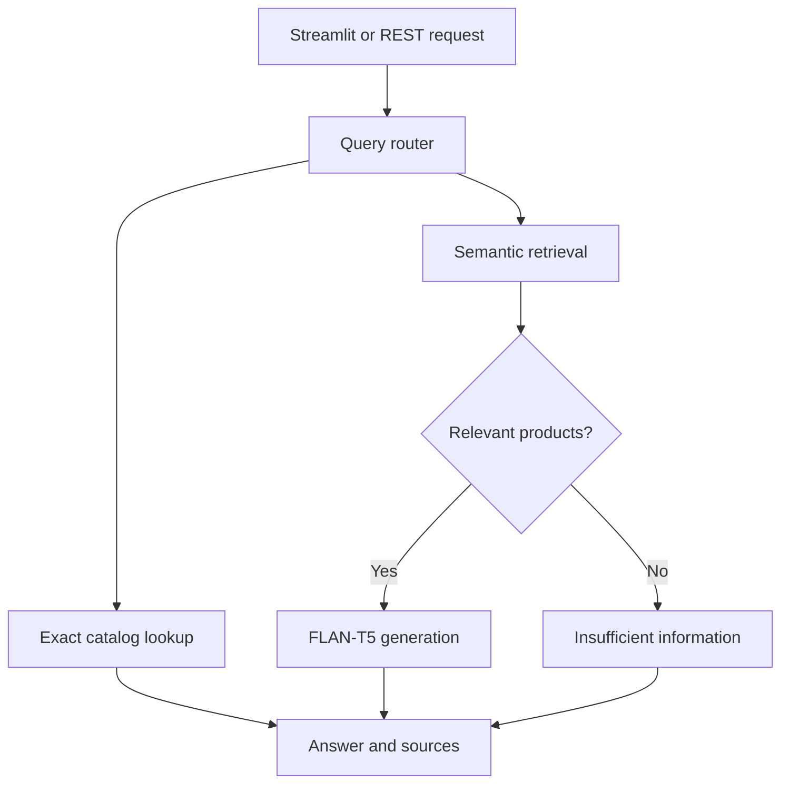

# Product RAG Assistant

A product-catalog question-answering application with exact price queries, semantic retrieval, a Streamlit interface, and a FastAPI endpoint.

**Python · Sentence Transformers · FAISS · FLAN-T5 · FastAPI · Streamlit**

[Portfolio](https://github.com/ajmal335) · [API guide](docs/API.md) · [Engineering notes](docs/ENGINEERING.md)

## What it does

- Routes supported English queries to exact catalog operations or semantic retrieval.
- Finds the cheapest/most expensive product and lists products in a recognized category.
- Retrieves normalized embeddings with FAISS; uses FLAN-T5 for semantic answers.
- Returns source product IDs, documents, similarity scores, and routing information.
- Exposes `POST /query`, `GET /health`, and interactive API documentation at `/docs`.
- Rejects invalid requests and returns a retryable response when inference is busy.

The included 20-product catalog is demonstration data, not current retail inventory or pricing.

## Architecture



## Quick start

Python 3.11 is recommended. Run commands from the repository root.

```bash
git clone https://github.com/ajmal335/Product_RAG_Assistant.git
cd Product_RAG_Assistant
python -m venv .venv
source .venv/bin/activate
python -m pip install -r requirements.txt
python -m uvicorn src.api:app --host 127.0.0.1 --port 8000
```

On Windows, activate with `.venv\Scripts\activate` instead. Open http://127.0.0.1:8000/docs to send requests.

```bash
curl -X POST http://127.0.0.1:8000/query \
  -H 'Content-Type: application/json' \
  -d '{"query":"Which product is the cheapest laptop?"}'
```

The example returns **HP Pavilion 15 (P005), $699**, from the bundled demonstration catalog.

For the original UI:

```bash
python -m streamlit run app.py
```

The first semantic query downloads the embedding and generation models from Hugging Face. Exact catalog queries do not load either model. Network access and sufficient RAM/disk are needed for semantic inference.

## Lightweight development and evaluation

The API, exact queries, routing, and unit tests work without model downloads:

```bash
python -m pip install -r requirements-dev.txt
python -m pytest -q
python -m experiments.evaluate_structured
```

**Validation:** 22 automated tests passed during the October 2026 update. Tests cover real catalog queries, routing regressions, request validation, concurrency rejection, failure handling, and abstention. Semantic generation is tested with injected doubles; these tests do not measure model answer quality. See [the reproducible structured evaluation](results/structured_evaluation.json).

The earlier `experiments/evaluate_rag.py` remains available for model-backed experiments after installing the full dependencies. Full neural inference and Docker builds were not executed during this update.

## Docker

```bash
docker build -t product-rag .
docker run --rm -p 127.0.0.1:8000:8000 product-rag
```

One worker is intentional: each worker would load its own model and catalog. Model cache is ephemeral unless a persistent volume is configured. Docker configuration is supplied, but requires verification on a Docker host.

## Repository map

| Path | Purpose |
|---|---|
| `src/query_router.py` | Rule-based intent/category routing |
| `src/retriever.py` | Catalog validation, exact lookup, lazy semantic index |
| `src/generator.py` | FLAN-T5 prompt and generation |
| `src/rag_pipeline.py` | Retrieval and answer orchestration |
| `src/api.py` | Validated REST interface |
| `app.py` | Streamlit UI |
| `tests/` | Offline automated regression tests |
| `experiments/` | Learning scripts and evaluations |
| `data/products.csv` | Bundled demonstration catalog |

## Limitations

This is a portfolio application, not a deployed production service. Routing uses English keyword rules and can misread negation or compound requests. Semantic generation can hallucinate; source retrieval and a prompt are not a guarantee of factual answers. The generator truncates input to 512 tokens, so some retrieved content may be omitted. Similarity scores are not calibrated confidence. No authentication, public-service rate limiting, durable index, or cloud deployment is included. Bind locally; add access controls and infrastructure limits before public hosting.

## Next engineering steps

Evaluate semantic answers against a labeled question set, add token-aware context budgeting, persist the index, and introduce authentication and deployment monitoring.
